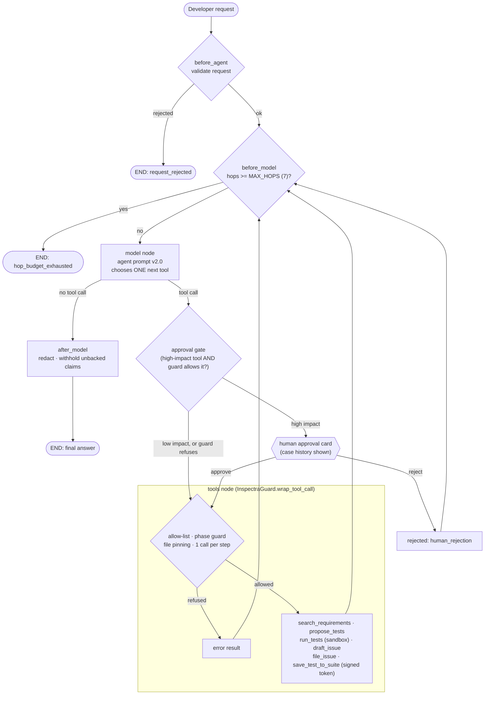

# Agent Task Contract — Week 5 (realigned)

**Project:** Software-Engineering QA Agent (Inspectra)
**Source of truth:** `AGENT_CONTRACT` in [`src/agent.py`](../../src/agent.py) (middleware in
[`src/guard_middleware.py`](../../src/guard_middleware.py)), checked by
[`tests/test_agent_contract.py`](../../tests/test_agent_contract.py)

## Goal

> For one requirement, propose and run tests in the sandbox, and either report a pass or draft an
> issue that a human approves or rejects.

## Approved tools

| Tool | Impact | Needs human approval |
|---|---|---|
| `search_requirements` | Low (read-only) | No |
| `propose_tests` | Low (writes only to `sandbox/generated/`) | No |
| `run_tests` | Low (sandboxed pytest) | No |
| `draft_issue` | Low (local draft) | No |
| `file_issue` | **High** | **Yes**: signed single-use token, minted only after approval |
| `save_test_to_suite` | **High** (changes `sut/tests/`) | **Yes** |

Any other tool name is refused by the allow-list in `InspectraGuard` (`guard_middleware.py`).

## State

| Field | Type | Meaning |
|---|---|---|
| `messages` | list of messages | The request, the model's tool calls and every tool result |
| `hops` | int | Completed assistant → tool round trips |

State lives in memory for one run only. (Explicit workflow fields such as `phase` are added in the
Week 6 realignment.)

## Limits

| Limit | Value | Why |
|---|---|---|
| `MAX_HOPS` | 7 | Longest legitimate path is 5 tool steps; 7 allows one re-plan and still ends in an answer |
| `MAX_CALLS_PER_STEP` | 1 | One action at a time, so every step can be traced and approved separately |
| Sandbox timeout | 60 s per test run | A hanging test cannot block the agent |
| Prompt version | `v2.0` (`prompts/agent_system_prompt_v2.0.txt`) | Rules are versioned, not hidden in code |

## Stop conditions

`all_tests_passed`, `issue_filed`, `human_rejection`, `tool_error`, `requirement_not_found`,
`hop_budget_exhausted`, `test_defect_reported`. Details are in
[`agent_control_loop_spec.md`](agent_control_loop_spec.md).

## Human hand-off points

1. **Before `file_issue`.** The console shows the tool, its arguments and the recent case history
   for the requirement, then asks `Authorize this action? [y/N]`.
2. **Before `save_test_to_suite`.** Same prompt. The agent never calls this unless the user asked.
3. **After any stop.** The developer reads the final answer and the draft; nothing is merged or
   deployed by the agent.

## Prohibited actions

The agent has no tool for any of these, so it cannot do them:
- merging branches or pull requests;
- deploying to any environment;
- reading secrets: the sandbox process gets no `GEMINI_API_KEY`, `GITHUB_TOKEN` or other variables;
- running arbitrary shell commands: pytest only, `shell=False`, allow-listed folders only;
- editing the SUT source in `sut/subscription_service/`.

## Agent architecture

