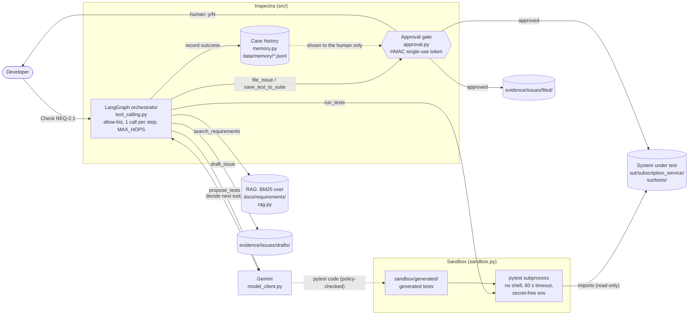

# Architecture — Week 4 (realigned)

**Project:** Software-Engineering QA Agent (Inspectra)

This diagram replaces `inspectra_architecture_week4 (1).png`, which showed the agent calling the
subscription service. The agent now **tests** the subscription service (the system under test,
`sut/`); it never operates it.

## Boundaries

| Component | Deterministic or AI | Notes |
|---|---|---|
| Requirement IDs (`REQ-X.Y`) | Deterministic | Parsed from `## Section X.Y:` headings |
| Retrieval | Deterministic (BM25) | Week 3 pipeline, unchanged |
| Choosing the next tool, writing test code, summarising failures | AI (Gemini) | Bounded by the allow-list and hop limit |
| Code policy check, path checks, timeout, env scrubbing | Deterministic | `sandbox.py` |
| Filing an issue, changing `sut/tests/` | Human decision | Token minted only after approval; verified inside the tool |
| Editing SUT source, merging, deploying, secrets, shell | Not possible | No tool exposes these actions |

The case history (dotted line) is printed for the human approver only. It is never sent to the
model and is not part of the arguments bound into the approval token.
