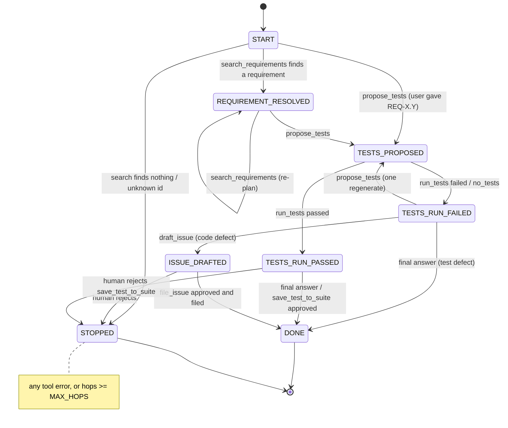

# State Model — Week 6 (realigned)

**Project:** Software-Engineering QA Agent (Inspectra)
**Code:** `AgentState` and `initial_state()` in [`src/tool_calling.py`](../../src/tool_calling.py); the phase
machine in [`src/workflow.py`](../../src/workflow.py); persistent memory in [`src/memory.py`](../../src/memory.py)
**Tests:** [`tests/test_agent_contract.py`](../../tests/test_agent_contract.py), [`tests/test_mcp_server.py`](../../tests/test_mcp_server.py)

This replaces the earlier state model of the subscription-upgrade agent (`messages` + `hops` only).
The old version is in git history.

## 1. Session state vs persistent memory

| | Session state (`AgentState`) | Persistent memory (`memory.py`) |
|---|---|---|
| Where | RAM, inside one LangGraph run | Disk: `data/memory/case_history.jsonl` (git-ignored) |
| Lifetime | One `run(prompt)` / one `demo/run_demo.py` run | Across runs, purged after 30 days |
| Contents | Messages, hop count, workflow fields | Metadata of executed tool calls per requirement |
| Who reads it | The model (messages only) and the deterministic guard | The human approver only, printed at the approval prompt |
| Sent to the LLM? | `messages` only | **Never** |

Nothing from memory is copied into `AgentState`, and `AgentState` has no field for it
(`test_memory_not_in_llm_state`).

## 2. Fields

| Field | Type | Written by | When | Read by |
|---|---|---|---|---|
| `messages` | list of messages | `assistant()` appends the model reply; `execute_tools()` appends one `ToolMessage` per call | Every step | `assistant()` (sent to the model); `run()` |
| `hops` | int | `execute_tools()` | +1 per tool step | `route_after_tools()` (stops at `MAX_HOPS = 7`) |
| `requirement_id` | str or None | `execute_tools()` via `workflow.apply_result` | After a successful `search_requirements` (top hit) or `propose_tests` | Case-history key; the approval display |
| `phase` | str | `execute_tools()`; `assistant()` on the final answer | After every executed tool; at the end | `workflow.check_call()` (phase guard) |
| `test_file` | str or None | `execute_tools()` | After `propose_tests` succeeds | Pins `run_tests` / `save_test_to_suite` to this file |
| `test_outcome` | str or None | `execute_tools()` | After `run_tests` (`passed` / `failed` / `no_tests`) | Phase transition; final report |
| `draft_path` | str or None | `execute_tools()` | After `draft_issue` succeeds | Pins `file_issue` to this draft |
| `stop_reason` | str or None | `execute_tools()`, or `assistant()` on the final answer | When the run reaches a stop condition | `run()` and `demo/run_demo.py` print it |
| `proposals_made` | int | `execute_tools()` | +1 per successful `propose_tests` | Allows exactly one regenerate after a failed run |

All workflow fields are set **from tool results, never from the model's text**. The model can
only ask for a tool; `workflow.apply_result()` decides what the result means for the state.
`proposals_made` is one field beyond the brief's list; it is needed to enforce "one regenerate".

## 3. Phases and allowed tools

`ALLOWED_TOOLS_BY_PHASE` (in `workflow.py`):

| Phase | Allowed tools |
|---|---|
| `START` | `search_requirements`, `propose_tests` |
| `REQUIREMENT_RESOLVED` | `propose_tests`, `search_requirements` |
| `TESTS_PROPOSED` | `run_tests` |
| `TESTS_RUN_PASSED` | `save_test_to_suite` |
| `TESTS_RUN_FAILED` | `draft_issue`, `propose_tests` (one regenerate only) |
| `ISSUE_DRAFTED` | `file_issue` |
| `DONE`, `STOPPED` | none |

A call that is not allowed returns an error `ToolMessage` such as
`Tool file_issue is not allowed in phase TESTS_RUN_FAILED.` and **is not executed**. No approval is
asked for, nothing is written, and nothing is recorded in memory.

**File pinning.** `run_tests` and `save_test_to_suite` may only use `test_file` from state, and
`file_issue` may only use `draft_path` from state. A model, or an instruction injected into a
requirement or test output, cannot point them at another file
(`test_file_issue_pinned_to_drafted_file`).

## 4. Stop reasons

| `stop_reason` | Set when | Final phase |
|---|---|---|
| `all_tests_passed` | `run_tests` passed | `DONE` |
| `issue_filed` | `file_issue` succeeded after approval | `DONE` |
| `human_rejection` | Human rejected `file_issue` / `save_test_to_suite` | `STOPPED` |
| `tool_error` | A tool returned `status: error` | `STOPPED` |
| `requirement_not_found` | No search hit, or unknown requirement id | `STOPPED` |
| `hop_budget_exhausted` | `hops >= MAX_HOPS` before a terminal phase | `STOPPED` |
| `test_defect_reported` | The model stopped in `TESTS_RUN_FAILED` without drafting (it judged the test wrong) | `DONE` |

## 5. Lifecycle

- **Created:** `initial_state(prompt)` sets `messages = [request]`, `hops = 0`, `phase = START`, the
  other fields to `None` and `proposals_made = 0`. Nothing is loaded from earlier runs.
- **Updated:** `execute_tools()` returns the changed fields after each step, and `assistant()`
  closes the run when the model gives its final answer.
- **Discarded:** when the run ends. Only the per-call metadata in `memory.py` outlives it.
- **MCP server:** keeps the same workflow fields per server session (`start_check` resets them), so
  MCP clients get the same phase guard and file pinning.
